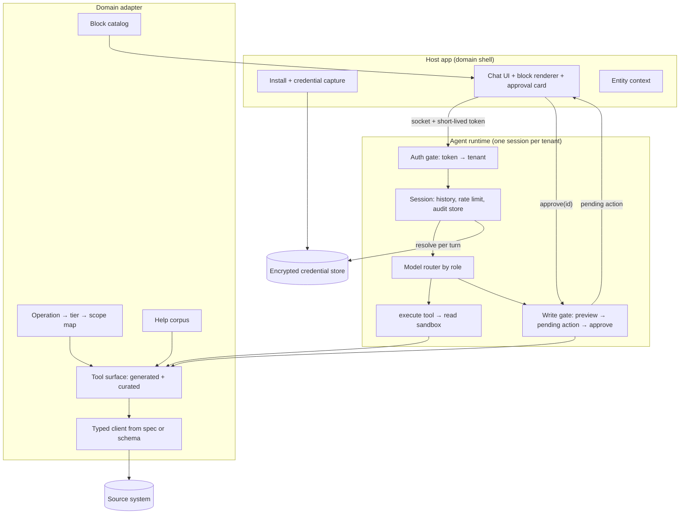

# Technical Architecture

The layers of the agent, the interface each one exposes, and what it costs to replace each one. The functional requirements these serve are in [functional.md](functional.md). Every claim about a vendor here has a source in [decisions.md](decisions.md).

## Layer map



## Layers

### 1. Host app

Owns everything that is specific to where the agent lives: the install or sign-in flow, the shell page, and the components that render blocks and approval cards.

- **Interface out:** a short-lived signed token naming one tenant, plus an optional `entityContext: {type, id}`.
- **Ask BC:** Next.js on Vercel. BigCommerce OAuth, then a JWT with a `storeHash` claim.
- **Rule:** the host never calls the model and never holds the agent's tools. It is a client of the runtime.

### 2. Auth gate

Verifies the token on connect and binds the connection to the tenant's session. A token for tenant A can never reach tenant B's session.

- **Ask BC:** `jwtVerify()` on the WebSocket upgrade; the claim must match the Durable Object room name (S-1).

### 3. Session runtime

One stateful session per tenant holds conversation history, the rate-limit window and the audit table. It sleeps when idle.

- **Interface:** `getModel()`, `getSystemPrompt()`, `getTools()`, `beforeTurn(ctx)`.
- **Ask BC:** `AskBC extends Think<Env>`, a Durable Object with SQLite storage.
- **Rule:** the session resolves credentials at the start of each turn, never at deploy time. They come from the credential store, decrypted in memory.

### 4. Model router

Picks a model by the **role** of the turn, not by the question.

| Role | When | Model class |
|---|---|---|
| Default | A fresh operator message; reads and answers | Fast, cheap tier |
| Continuation | Retry after a tool error, the turn after an approval, recovery after a restart | Stronger tier |

- **Ask BC:** `beforeTurn()` returns the stronger model when `ctx.continuation` is true.
- **Rule:** pin model IDs in one place. Re-measure the split when a new model generation ships.

### 5. Read sandbox (code mode)

The model gets one `execute` tool. Its input is a script that calls typed functions, such as `codemode.getOrders(...)`. The script runs in an isolate with no network. Its only route out is the typed functions, which run on the host with the tenant's credentials.

- **Why:** one script can paginate, run calls in parallel and join in memory. That replaces many model round-trips with one, and intermediate data never passes through the model's context.
- **Ask BC:** `createExecuteTool({ tools: readTools, loader: env.LOADER, timeout: 30_000 })` over a Dynamic Worker. Outbound network is blocked by default (`globalOutbound: null`).
- **Rule:** the sandbox never sees a secret. Credentials stay on the host side of the function boundary.

### 6. Write gate

Every operation in the write or destructive tier passes through one gate that the host enforces:

```
model calls write(args)
  └─ host validates args, builds a preview, stores pendingAction{id, op, args, tenant}
  └─ returns {status: "pending", id, preview}       ← the model's turn ends here
operator clicks Approve in the UI
  └─ host redeems id → runs op(args) → writes audit row → resumes the model
operator clicks Reject
  └─ host marks id denied → the model sees the denial
```

- **Rule:** the model cannot redeem a pending action. Approval comes in through a UI event, not a tool argument.
- **Rule:** an approval is bound to the exact arguments in the preview. If the arguments change, the operator approves again.
- **Current primitives that provide this:**
  - AI SDK tool approval (`toolApproval`, which replaces the deprecated per-tool `needsApproval`).
  - Codemode connector tools marked `requiresApproval: true`, which pause `execute()` until `approve()` or `reject()` runs.
- **Ask BC today:** write tools take a `confirmed` boolean that the model sets itself. This is a known gap; see [decisions.md](decisions.md) D-4.

### 7. Tool surface

The functions the sandbox and the write gate can call. This is where the domain adapter does most of its work. The surface can come from any of three shapes; pick one per source:

| Shape | Use when | How it plugs in |
|---|---|---|
| **Generated from spec** | The source publishes a good OpenAPI spec, and you connect to one platform | Codemode `OpenApiConnector`: one typed tool per operation, found through `codemode.search` / `describe` |
| **Vendor MCP server** | The vendor runs one, or you connect to several services | Codemode `McpConnector`: each MCP tool becomes a method in the sandbox |
| **Hand-curated wrappers** | The spec is thin or wrong, the source is a database or files, or an operation needs domain logic (counts, joins, V2/V3 quirks) | Typed `tool()` definitions over a typed client |

Code mode sits on top of all three, so the model always writes a script either way. Mix shapes freely: generate the bulk of the surface and hand-curate the operations where the spec misleads the model.

Curation rules, whatever the shape:

- Name tools by namespace and verb (`orders.list`, `orders.count`). Write descriptions that say when to use the tool, not only what it returns.
- Give a dedicated count tool for every listable entity. "How many" must never mean "length of page one".
- Return high-signal fields and real pagination metadata. Map raw IDs to names where the operator will read them.
- Errors say what to do next ("missing scope `store_v2_orders`"), not only the HTTP status.
- Tag each tool with its tier from the scope map. Read-tier tools go into the sandbox; write-tier tools go through the gate.
- Filter the surface by the tenant's granted scopes before the model sees it.

**Sources that are not APIs.** A SQL database, a warehouse or a document store fits the same layer. Expose a read-only query function, such as `query(sql)` against a read replica or a role with SELECT only, plus a schema description. Writes still go through the gate as named operations, never as free-form SQL.

### 8. Block protocol

The model writes fenced `block` JSON, `{type, props}`, inside its reply. The client parses it and mounts the matching component. One catalog file is the single source of truth: the runtime renders it into the system prompt, and the client validates against it.

- **Ask BC:** `workers/agent-runtime/src/blocks.ts`, with 7 components in `src/components/chat/blocks/`.
- **Rule:** an unknown block type renders as an error card, never as raw JSON.

### 9. Help corpus

Answers "how do I…" questions without reading the source. Start with a keyword-scored list of title, URL and keywords. Move to embeddings only when the corpus grows past what keywords can rank.

- **Ask BC:** `doc-search.ts`, a static keyword list.

### 10. Audit and observability

Every `execute` call and every write produces one audit row: tenant, tool, truncated input, a result-size proxy, duration and error. Write rows also record who approved them.

- **Ask BC:** DO SQLite `write_audit`, plus an `execute` wrapper in `getTools()` that logs reads.
- **Why reads too:** a stolen token used for slow data theft shows up as an unusual rate of `execute` calls.

### 11. Eval harness

Required, not optional. There are three suites, and each runs against a seeded test tenant:

| Suite | Checks | Fails when |
|---|---|---|
| Golden questions | 20–50 real operator questions with known answers | The answer is wrong, or the reply invents data |
| Tool selection | That a question routes to the right functions, such as a count tool for "how many" | The wrong tool is called, or a page length is used as a count |
| Write gate (adversarial) | Prompt injection in source data, a model call that tries `approve`, changed arguments after a preview | Any write runs without a matching operator approval |

- **Ask BC today:** no eval harness. A `/smoke` endpoint runs one turn. This is a known gap.

## What is fixed and what is swappable

| Layer | Fixed in the pattern | Current implementation | Swap cost |
|---|---|---|---|
| Session runtime | One stateful session per tenant | `@cloudflare/think` on Durable Objects | High: history, scheduling and the loop live here |
| Read sandbox | Isolate, no network, typed functions | `@cloudflare/codemode` + Worker Loader | Medium: codemode exposes an `Executor` interface |
| Write gate | Host-enforced approval | AI SDK approval or codemode `requiresApproval` | Low |
| Tool surface | Typed, tiered, scope-filtered | `openapi-typescript` + `openapi-fetch` + `tool()` | Low per tool |
| Model router | By role | Anthropic models via `@ai-sdk/anthropic` | Low |
| Block protocol | Fenced JSON + one catalog | React components | Low |
| Credential store | Encrypted at rest, resolved per turn | Upstash Redis, AES-256-GCM | Low |

`@cloudflare/think` and `@cloudflare/codemode` are labeled experimental by their maintainers. Pin exact versions and read the release notes before you upgrade.

## Security invariants

These hold in every domain. A design that breaks one is not this pattern.

1. The sandbox has no network and no secrets.
2. No write runs without an operator approval that the host recorded.
3. A tenant's session can reach only that tenant's credentials.
4. The model sees only the tools the tenant's scopes allow.
5. Every read script and every write is audited.
6. Source data is untrusted input. Text inside a record can never approve a write or widen the tool surface.
